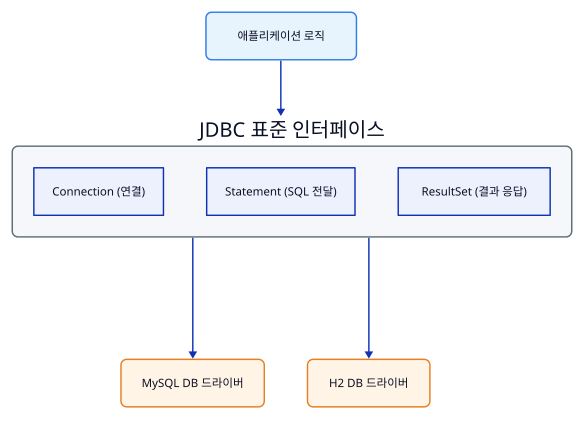
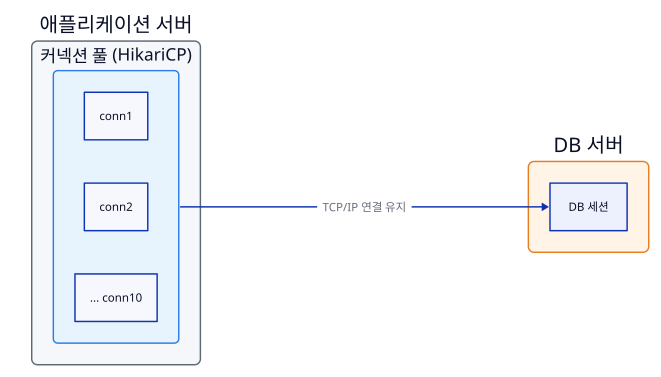
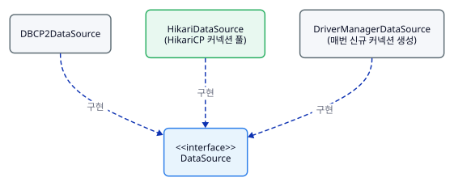
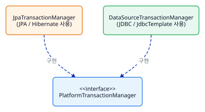
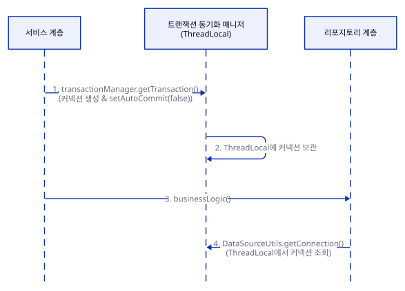
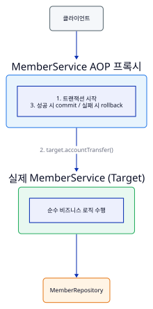
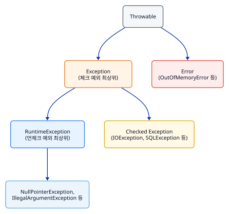
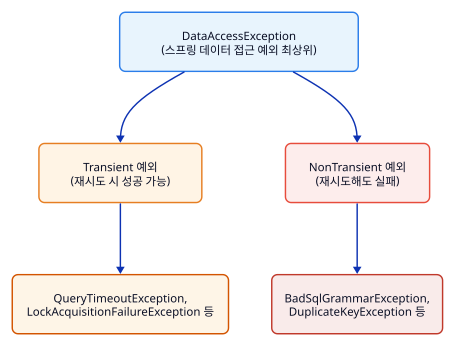

# 스프링 DB 1편: 데이터 접근 핵심 원리

## 1. JDBC 이해 (Java Database Connectivity)

### 1.1 JDBC 등장 배경 및 표준 인터페이스

애플리케이션을 개발할 때 데이터를 안전하게 보관하기 위해 관계형 데이터베이스(RDB)를 사용합니다. 데이터베이스마다 커넥션을 연결하고 SQL을 전달하여 결과를 응답받는 방식이 모두 달랐기 때문에, DB를 변경할 때마다 애플리케이션 코드를 전면 수정해야 하는 문제가 있었습니다.

이를 해결하기 위해 자바는 **JDBC(Java Database Connectivity)** 표준 인터페이스를 정의했습니다.



#### JDBC 표준 인터페이스 핵심 3가지
1. **`java.sql.Connection`**: 데이터베이스와의 연결을 담당합니다.
2. **`java.sql.Statement`**: SQL 문장을 담고 데이터베이스에 실행 요청을 보냅니다. (`PreparedStatement`는 파라미터 바인딩 지원)
3. **`java.sql.ResultSet`**: SELECT 쿼리의 실행 결과를 반환받아 커서(cursor) 형태로 조회합니다.

### 1.2 DriverManager 동작 원리
`DriverManager`는 라이브러리에 등록된 DB 드라이버들을 관리하고, URL 정보(`jdbc:h2:tcp://...`)를 바탕으로 적절한 드라이버를 찾아 커넥션을 획득합니다.

```
1. 애플리케이션 -> DriverManager.getConnection(URL, USERNAME, PASSWORD) 호출
2. DriverManager -> 등록된 드라이버 목록(H2, MySQL 등) 순회하며 URL 처리 가능 여부 확인
3. H2 드라이버 -> "jdbc:h2" URL 인식 후 실제 DB 커넥션 생성 및 반환 (org.h2.jdbc.JdbcConnection)
```

### 1.3 JDBC 기반 CRUD 개발 및 리소스 정리 예제

```java
@Slf4j
public class MemberRepositoryV0 {

    public Member save(Member member) throws SQLException {
        String sql = "insert into member(member_id, money) values(?, ?)";
        Connection con = null;
        PreparedStatement pstmt = null;

        try {
            con = getConnection();
            pstmt = con.prepareStatement(sql);
            pstmt.setString(1, member.getMemberId());
            pstmt.setInt(2, member.getMoney());
            pstmt.executeUpdate(); // 영향받은 row 수 반환
            return member;
        } catch (SQLException e) {
            log.error("db error", e);
            throw e;
        } finally {
            close(con, pstmt, null); // 리소스 해제는 필수! (역순 정리)
        }
    }

    public Member findById(String memberId) throws SQLException {
        String sql = "select * from member where member_id = ?";
        Connection con = null;
        PreparedStatement pstmt = null;
        ResultSet rs = null;

        try {
            con = getConnection();
            pstmt = con.prepareStatement(sql);
            pstmt.setString(1, memberId);
            rs = pstmt.executeQuery();

            if (rs.next()) { // 커서를 최초 1회 이동시켜야 데이터 접근 가능
                Member member = new Member();
                member.setMemberId(rs.getString("member_id"));
                member.setMoney(rs.getInt("money"));
                return member;
            } else {
                throw new NoSuchElementException("member not found memberId=" + memberId);
            }
        } finally {
            close(con, pstmt, rs);
        }
    }

    private void close(Connection con, Statement stmt, ResultSet rs) {
        if (rs != null) { try { rs.close(); } catch (SQLException e) { log.info("error", e); } }
        if (stmt != null) { try { stmt.close(); } catch (SQLException e) { log.info("error", e); } }
        if (con != null) { try { con.close(); } catch (SQLException e) { log.info("error", e); } }
    }

    private Connection getConnection() {
        return DBConnectionUtil.getConnection();
    }
}
```

> [!IMPORTANT]
> **리소스 누수 방지**
> `Connection`, `PreparedStatement`, `ResultSet` 등은 사용 후 반드시 `finally` 블록에서 닫아주어야 합니다. 리소스를 정리하지 않으면 커넥션이 계속 유지되어 **커넥션 부족으로 인한 서버 장애**가 발생할 수 있습니다.

### 1.4 데이터 접근 기술 발전 과정 비교

| 구분 | pure JDBC | SQL Mapper (MyBatis, JdbcTemplate) | ORM (JPA, Hibernate, Querydsl) |
| :--- | :--- | :--- | :--- |
| **SQL 작성** | 개발자가 직접 SQL 및 파라미터 바인딩 작성 | XML 또는 자바 코드에 SQL 분리 작성 | SQL을 직접 작성하지 않고 객체 기반으로 처리 |
| **반복 코드** | Connection, Statement, ResultSet 매번 수동 관리 | JDBC 반복 코드를 프레임워크가 자동화 | CRUD 및 매핑 전체를 프레임워크가 전담 |
| **장단점** | 가장 원시적, 보일러플레이트 코드 극심 | SQL 제어가 자유로우나 SQL 종속적 | 생산성 극대화, RDB와 객체 간 패러다임 불일치 해결 |

## 2. 커넥션 풀과 DataSource 이해

### 2.1 매번 커넥션을 획득할 때의 문제점
1. 애플리케이션이 DB 드라이버를 통해 커넥션 조회
2. DB 드라이버가 DB와 TCP/IP 3-way handshake 세션 연결
3. ID/PW 등 인증 정보 전달 및 DB 내부 세션 생성
4. 커넥션 생성 완료 후 응답 반환

매번 쿼리를 실행할 때마다 이 과정을 반복하면 **응답 속도가 저하**되고 사용자 경험에 치명적인 영향을 줍니다.

### 2.2 커넥션 풀 (Connection Pool) 동작 원리

애플리케이션 시작 시점에 미리 설정된 수(기본값 10개)만큼 커넥션을 생성하여 **풀(Pool)** 에 보관해 둡니다.



- **획득**: 커넥션 풀에 생성되어 있는 커넥션 객체 참조를 즉시 가져와 사용합니다.
- **반납**: 사용이 끝난 커넥션은 `close()`를 호출하더라도 **연결을 끊지 않고 재사용을 위해 커넥션 풀에 반환**합니다.
- 최근 표준 커넥션 풀은 **HikariCP**를 사용하며 스프링 부트의 기본 커넥션 풀로 지정되어 있습니다.

### 2.3 DataSource 추상화와 설정/사용의 분리

자바는 커넥션을 획득하는 방법을 추상화하기 위해 `javax.sql.DataSource` 인터페이스를 제공합니다.

```java
public interface DataSource {
    Connection getConnection() throws SQLException;
}
```



#### 설정과 사용의 분리 (Separation of Concerns)

- **설정**: `URL`, `USERNAME`, `PASSWORD` 등 DB 접속 정보를 `DataSource` 생성 시점에 단 한 번 설정합니다.
- **사용**: 리포지토리(Repository)는 접속 정보를 전혀 알 필요 없이 단지 `dataSource.getConnection()`만 호출하여 사용합니다.

```java
// 1. 설정 (Configuration)
HikariDataSource dataSource = new HikariDataSource();
dataSource.setJdbcUrl(URL);
dataSource.setUsername(USERNAME);
dataSource.setPassword(PASSWORD);
dataSource.setMaximumPoolSize(10);

// 2. 사용 (Usage)
MemberRepositoryV1 repository = new MemberRepositoryV1(dataSource);
repository.save(member); // 내부에서 dataSource.getConnection() 호출
```

## 3. 트랜잭션 이해 (Transaction)

### 3.1 트랜잭션 개념 및 ACID 원칙

트랜잭션(Transaction)은 데이터베이스에서 **하나의 거래를 안전하게 처리하기 위한 작업 단위**입니다. 모든 작업이 성공해야 데이터베이스에 반영되는 **커밋(Commit)**이 이루어지며, 단 하나라도 실패하면 거래 이전 상태로 원복하는 **롤백(Rollback)**이 수행됩니다.

#### 트랜잭션 ACID 4대 요소

1. **원자성 (Atomicity)**: 트랜잭션 내 작업들은 하나의 작업처럼 모두 성공하거나 모두 실패해야 함.
2. **일관성 (Consistency)**: 무결성 제약 조건 등 DB의 상태는 항상 일관성 있게 유지되어야 함.
3. **격리성 (Isolation)**: 동시에 실행되는 트랜잭션들이 서로 간섭하지 못하도록 격리함. (격리 수준 설정 가능)
4. **지속성 (Durability)**: 성공한 트랜잭션 결과는 영구적으로 기록되어 시스템 장애가 발생해도 보존됨.

### 3.2 DB 세션과 커밋/롤백 메커니즘

클라이언트가 DB 서버에 연결하면 DB 서버 내부에 **세션(Session)**이 생성됩니다. 모든 SQL 실행은 세션을 통해 전달되며, **커밋(Commit)**을 호출하기 전까지 변경된 데이터는 해당 세션에만 임시로 보이고 다른 세션에는 보이지 않습니다.

```
[세션 1 (수동 커밋)]                                    [세션 2]
1. set autocommit false;
2. update member set money=8000 where id='A';
   (DB 임시 영역에 저장됨)
3. select -> money=8000 조회됨                         3. select -> money=10000 조회됨 (커밋 전이므로 변경 전 데이터)
4. commit;
   (실제 DB 반영 완료)
                                                       5. select -> money=8000 조회됨 (커밋 후 반영 확인)
```

- **자동 커밋 (`set autocommit true`)**: 쿼리 하나 실행 직후 즉시 커밋. 트랜잭션 다중 작업 불가.
- **수동 커밋 (`set autocommit false`)**: 개발자가 직접 커밋/롤백 제어. **수동 커밋으로 전환하는 것이 곧 트랜잭션의 시작**을 의미.

### 3.3 DB 락(Lock) 메커니즘

동시에 여러 세션이 같은 로우(Row)의 데이터를 수정하는 경우 데이터 정합성이 깨지는 것을 방지하기 위해 DB는 **락(Lock)** 개념을 제공합니다.

1. **변경과 락**: 세션 1이 `UPDATE`를 수행할 때 해당 로우의 락을 먼저 획득합니다. 세션 2가 동일 로우를 `UPDATE`하려 하면 세션 1이 커밋/롤백하여 락을 반납할 때까지 대기(`LOCK_TIMEOUT`)합니다.
2. **조회와 락 (`SELECT FOR UPDATE`)**: 일반적인 SELECT는 락 없이 조회하지만, 중요 금융 계산 등 트랜잭션 종료 시까지 데이터 변경을 강제로 막아야 할 때 `SELECT ... FOR UPDATE` 구문으로 비관적 락(Pessimistic Lock)을 걸 수 있습니다.

### 3.4 계좌이체 비즈니스 로직과 트랜잭션 연동

#### 트랜잭션 적용 전 문제 상황

`MemberA` -> `MemberB`로 2,000원 계좌이체 시:
1. `MemberA` 돈 2,000원 차감 (성공)
2. `MemberB` 계좌 조회 또는 입력 중 예외 발생 (실패)
3. **결과**: `MemberA` 돈만 줄어들고 `MemberB` 돈은 늘어나지 않는 심각한 데이터 불일치 발생!

#### 트랜잭션 적용 후 (파라미터 커넥션 전달 방식)

```java
public void accountTransfer(String fromId, String toId, int money) throws SQLException {
    Connection con = dataSource.getConnection();
    try {
        con.setAutoCommit(false); // 1. 트랜잭션 시작

        // 2. 비즈니스 로직 수행 (동일한 Connection을 파라미터로 계속 전달)
        bizLogic(con, fromId, toId, money);

        con.commit(); // 3. 성공 시 커밋
    } catch (Exception e) {
        con.rollback(); // 4. 실패 시 롤백
        throw new IllegalStateException(e);
    } finally {
        release(con); // 5. 커넥션 풀 반납 전 autocommit true 원복 후 close
    }
}
```

## 4. 스프링과 문제 해결 - 트랜잭션

### 4.1 기존 서비스 계층 트랜잭션 코드의 문제점

1. **트랜잭션 코드 누수**: 서비스 계층에 `Connection`, `javax.sql.DataSource`, `SQLException` 등 JDBC 전용 기술이 노출되어 순수한 비즈니스 로직이 오염됩니다.
2. **커넥션 파라미터 전달 중복**: 동일 커넥션 유지를 위해 모든 리포지토리 메서드에 `Connection con` 파라미터를 중복 선언해야 합니다.
3. **반복적인 boilerplate 코드**: `try-catch-finally` 구문으로 인한 커밋/롤백/리소스 해제 코드의 무한 반복.

### 4.2 스프링의 트랜잭션 추상화 (`PlatformTransactionManager`)

스프링은 데이터 접근 기술(JDBC, JPA, MyBatis 등)에 의존하지 않고 트랜잭션을 일관되게 다룰 수 있도록 추상화 인터페이스를 제공합니다.

```java
public interface PlatformTransactionManager extends TransactionManager {
    TransactionStatus getTransaction(@Nullable TransactionDefinition definition) throws TransactionException;
    void commit(TransactionStatus status) throws TransactionException;
    void rollback(TransactionStatus status) throws TransactionException;
}
```



### 4.3 트랜잭션 동기화 매니저 (`TransactionSynchronizationManager`)

스프링은 **`ThreadLocal`**을 기반으로 커넥션을 동기화하는 **`TransactionSynchronizationManager`**를 제공합니다. 파라미터로 커넥션을 넘기지 않아도 멀티쓰레드 환경에서 안전하게 커넥션을 보관하고 유지할 수 있습니다.



- 리포지토리에서는 `DataSourceUtils.getConnection(dataSource)` 및 `DataSourceUtils.releaseConnection(con, dataSource)`를 사용하여 동기화 매니저와 연동합니다.

### 4.4 TransactionTemplate (템플릿 콜백 패턴)

반복되는 `try-catch` 커밋/롤백 로직을 **`TransactionTemplate`** 을 통해 깔끔하게 제거할 수 있습니다.

```java
public class MemberServiceV3_2 {
    private final TransactionTemplate txTemplate;
    private final MemberRepositoryV3 memberRepository;

    public MemberServiceV3_2(PlatformTransactionManager transactionManager, MemberRepositoryV3 memberRepository) {
        this.txTemplate = new TransactionTemplate(transactionManager);
        this.memberRepository = memberRepository;
    }

    public void accountTransfer(String fromId, String toId, int money) {
        txTemplate.executeWithoutResult((status) -> {
            try {
                bizLogic(fromId, toId, money); // 언체크 예외 발생 시 자동 롤백
            } catch (SQLException e) {
                throw new IllegalStateException(e);
            }
        });
    }
}
```

### 4.5 트랜잭션 AOP (`@Transactional`) 동작 원리

서비스 계층에서 트랜잭션 처리 기술 로직을 완전히 제거하고, 순수 비즈니스 로직만 남기기 위해 스프링 AOP 프록시를 적용합니다.



#### `@Transactional` 적용 코드
```java
@Slf4j
@RequiredArgsConstructor
public class MemberServiceV3_3 {

    private final MemberRepositoryV3 memberRepository;

    @Transactional // 스프링 AOP 프록시가 트랜잭션 커밋/롤백을 자동 처리!
    public void accountTransfer(String fromId, String toId, int money) throws SQLException {
        bizLogic(fromId, toId, money);
    }
}
```

### 4.6 스프링 부트의 자동 리소스 등록

스프링 부트는 `application.properties`의 설정을 바탕으로 주요 리소스를 스프링 빈에 자동으로 등록해 줍니다.

```properties
spring.datasource.url=jdbc:h2:tcp://localhost/~/test
spring.datasource.username=sa
spring.datasource.password=
```

1. **`DataSource`**: `HikariDataSource` 자동 생성 및 빈 등록.
2. **`PlatformTransactionManager`**: 클래스패스 라이브러리를 판단하여 JDBC는 `JdbcTransactionManager` (또는 `DataSourceTransactionManager`), JPA는 `JpaTransactionManager`를 자동 등록.

## 5. 자바 예외 이해 (Exception)

### 5.1 자바 예외 계층 구조
자바에서 예외 객체의 최상위 부모는 `java.lang.Throwable`이며, 하위에 `Error`와 `Exception`으로 나뉩니다.



### 5.2 체크 예외 vs 언체크 예외 비교

| 구분 | 체크 예외 (Checked Exception) | 언체크 예외 (Unchecked Exception) |
| :--- | :--- | :--- |
| **상속** | `Exception` 및 그 하위 클래스 (`RuntimeException` 제외) | `RuntimeException` 및 그 하위 클래스 |
| **컴파일러 체크** | **필수** (잡거나 `throws` 명시 필요) | **안 함** (명시하지 않아도 자동 던짐) |
| **장점** | 개발자가 실수로 예외를 누락하지 않도록 컴파일 타임에 검증 | 불필요한 예외 선언 및 의존성 고리를 제거하여 코드 단순화 |
| **단점** | 복구 불가능한 시스템 예외까지 모든 상위 레이어에 `throws` 선언 유출 | 개발자가 예외 발생 가능성을 놓칠 위험 존재 (문서화 필요) |

### 5.3 체크 예외의 심각한 문제점

```
[DB Repository] (SQLException 발생) 
       |
       v
  [Service] (처리 불가 -> throws SQLException 선언)
       |
       v
 [Controller] (처리 불가 -> throws SQLException 선언)
       |
       v
[ExceptionHandler / Servlet] (공통 예외 처리)
```

1. **복구 불가능한 예외의 전파**: SQL 문법 오류, DB 다운, 네트워크 장애 등 애플리케이션 로직에서 복구할 수 없는 예외들이 컨트롤러와 서비스 계층으로 계속 던져집니다.
2. **의존관계 누수**: 서비스와 컨트롤러 계층이 `java.sql.SQLException`이라는 특정 구현 기술 예외에 강하게 결합됩니다. 향후 JPA(`PersistenceException`)로 전환할 경우 모든 서비스/컨트롤러의 `throws` 선언을 수정해야 하므로 **OCP, DI 원칙이 파괴**됩니다.

### 5.4 예외 전환 시 기존 예외(Cause) 포함 필수 규칙

체크 예외를 언체크 예외로 변환하여 던질 때는 **반드시 원인이 되는 기존 예외(`cause`)를 생성자에 전달**해야 합니다.

```java
// 올바른 예외 전환 (기존 예외 e 포함)
try {
    runSQL();
} catch (SQLException e) {
    throw new RuntimeSQLException(e); // cause 포함
}

// 잘못된 예외 전환 (기존 예외 누락!)
try {
    runSQL();
} catch (SQLException e) {
    throw new RuntimeSQLException(); // 원인 예외 유실 -> 스택 트레이스에서 진짜 DB 오류 원인을 확인 불가능!
}
```

## 6. 스프링과 문제 해결 - 예외 처리, 반복

### 6.1 예외 누수 문제 해결 및 인터페이스 도입

서비스 계층이 특정 데이터 접근 기술에 종속되지 않도록 리포지토리 인터페이스를 정의합니다. 이때 체크 예외(`SQLException`)를 인터페이스 메서드에 선언하면 인터페이스마저 JDBC에 종속되므로, **체크 예외를 언체크(런타임) 예외로 전환**하여 던져야 합니다.

```java
public interface MemberRepository {
    Member save(Member member);
    Member findById(String memberId);
    void update(String memberId, int money);
    void delete(String memberId);
}
```

### 6.2 데이터 접근 예외 직접 만들기 (ErrorCode 활용)

특정 DB 에러 코드(예: H2의 PK 중복 에러 코드 `23505`)를 감지하여 비즈니스 로직에서 예외를 복구하려는 경우, 직접 작성한 순수 런타임 예외로 전환합니다.

```java
public class MyDuplicateKeyException extends MyDbException {
    public MyDuplicateKeyException(Throwable cause) { super(cause); }
}

// Repository 내부
try {
    pstmt.executeUpdate();
} catch (SQLException e) {
    if (e.getErrorCode() == 23505) {
        throw new MyDuplicateKeyException(e); // 순수 자바 런타임 예외로 전환!
    }
    throw new MyDbException(e);
}
```

### 6.3 스프링의 일관된 예외 추상화 (`DataAccessException`)

DB마다 오류 코드가 모두 다르기 때문에, 스프링은 데이터 접근 계층을 위한 통합 예외 계층 구조인 **`DataAccessException`**을 제공합니다.



### 6.4 SQLExceptionTranslator (자동 예외 변환기)

스프링은 DB의 에러 코드를 `sql-error-codes.xml` 파일에 매핑해 두고, `SQLErrorCodeSQLExceptionTranslator`를 통해 자동으로 적절한 `DataAccessException` 하위 예외로 변환해 줍니다.

```java
SQLExceptionTranslator exTranslator = new SQLErrorCodeSQLExceptionTranslator(dataSource);
DataAccessException resultEx = exTranslator.translate("task name", sql, sqlException);
```

```java
// MemberRepositoryV4_2 적용 코드
try {
    con = getConnection();
    pstmt = con.prepareStatement(sql);
    pstmt.executeUpdate();
} catch (SQLException e) {
    throw exTranslator.translate("save", sql, e); // BadSqlGrammarException, DuplicateKeyException 등으로 자동 변환!
}
```

### 6.5 JdbcTemplate을 통한 반복 제거

`JdbcTemplate`은 반복적인 커넥션 연결/동기화, SQL 실행, 리소스 정리(`close`), 예외 변환기 적용까지 모든 과정을 **템플릿 콜백 패턴**으로 자동 처리합니다.

```java
@Slf4j
public class MemberRepositoryV5 implements MemberRepository {

    private final JdbcTemplate template;

    public MemberRepositoryV5(DataSource dataSource) {
        this.template = new JdbcTemplate(dataSource);
    }

    @Override
    public Member save(Member member) {
        String sql = "insert into member(member_id, money) values(?, ?)";
        template.update(sql, member.getMemberId(), member.getMoney());
        return member;
    }

    @Override
    public Member findById(String memberId) {
        String sql = "select * from member where member_id = ?";
        return template.queryForObject(sql, memberRowMapper(), memberId);
    }

    private RowMapper<Member> memberRowMapper() {
        return (rs, rowNum) -> {
            Member member = new Member();
            member.setMemberId(rs.getString("member_id"));
            member.setMoney(rs.getInt("money"));
            return member;
        };
    }
}
```

## 7. 최종 요약 및 핵심 정리

1. **JDBC 표준화**: DB 변경 시 애플리케이션 코드 수정을 최소화하기 위해 Connection, Statement, ResultSet 인터페이스를 표준화했다.
2. **커넥션 풀 (HikariCP)**: TCP/IP 연결 생성 비용을 줄이기 위해 커넥션을 미리 생성해두고 재사용한다.
3. **DataSource 추상화**: 커넥션 획득 방법을 추상화하여 `DriverManager`에서 커넥션 풀 기반으로 변경해도 애플리케이션 코드를 유지할 수 있다.
4. **트랜잭션 ACID & 수동 커밋**: 계좌이체 등 원자성이 중요한 작업은 수동 커밋 모드(`autocommit false`)로 시작하여 성공 시 `commit`, 실패 시 `rollback` 한다.
5. **트랜잭션 추상화 (`PlatformTransactionManager`)**: 특정 DB 기술(JDBC, JPA)에 종속되지 않고 트랜잭션을 관리할 수 있도록 추상화한다.
6. **트랜잭션 동기화 매니저**: `ThreadLocal`을 기반으로 트랜잭션 수명주기 동안 동일한 커넥션을 파라미터 전달 없이 안전하게 유지한다.
7. **선언적 트랜잭션 (`@Transactional`)**: AOP 프록시를 활용하여 서비스 계층의 트랜잭션 기술 코드를 완벽히 분리하고 순수 비즈니스 로직만 남긴다.
8. **언체크 예외 전환**: 복구 불가능한 시스템 예외(`SQLException`)를 런타임 예외로 전환하여 서비스/컨트롤러의 예외 누수를 막고 OCP, DI를 지킨다. (기존 예외 `cause` 포함 필수)
9. **스프링 예외 추상화 (`DataAccessException`)**: DB별 에러 코드를 `SQLExceptionTranslator`가 일관된 스프링 데이터 접근 예외로 자동 변환한다.
10. **`JdbcTemplate`**: JDBC의 수많은 리소스 해제, 예외 변환, 커넥션 동기화 등의 보일러플레이트 코드를 완벽히 제거한다.
