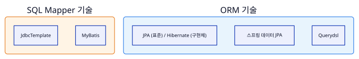
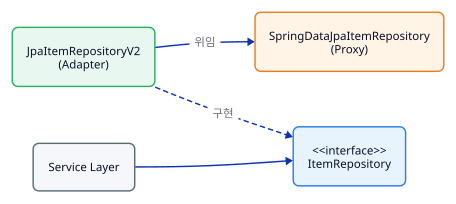
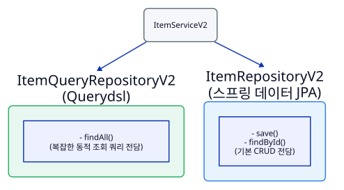
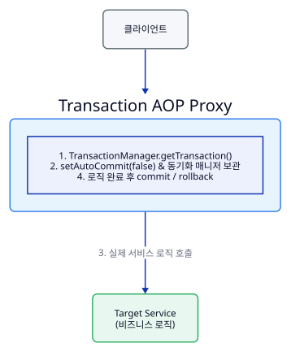
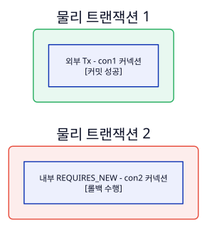

# 스프링 DB 2편: 데이터 접근 활용 기술

## 1. 데이터 접근 기술 시작 및 개요

### 1.1 SQL Mapper vs ORM 비교

실무에서 주로 사용하는 데이터 접근 기술은 크게 **SQL Mapper**와 **ORM(Object-Relational Mapping)** 기술로 분류됩니다.

*   **SQL Mapper (JdbcTemplate, MyBatis)**: 개발자가 직접 SQL을 작성하고, 프레임워크는 SQL 실행 결과와 객체 간의 매핑을 편리하게 처리해 줍니다. SQL을 직접 제어할 수 있다는 장점이 있으나, CRUD 작업 시 반복적인 SQL 작성 부담이 존재합니다.
*   **ORM 기술 (JPA, Hibernate, 스프링 데이터 JPA, Querydsl)**: 기본적인 SQL을 개발자가 직접 작성하지 않고, ORM 프레임워크가 객체와 관계형 데이터베이스 테이블 간의 매핑 정보를 바탕으로 SQL을 자동 생성하여 실행해 줍니다. 개발자는 마치 자바 컬렉션에 객체를 저장하고 조회하듯 데이터베이스를 다룰 수 있습니다.



### 1.2 예제 프로젝트 구조 분석 (`Item`, `ItemRepository`, DTO/Cond 컨벤션)

다양한 데이터 접근 기술을 점진적으로 적용하기 위해 기본 상품 관리 프로젝트(`itemservice-db`)를 구성합니다.

*   **도메인 객체 (`Item`)**: 상품 식별자(`id`), 상품명(`itemName`), 가격(`price`), 수량(`quantity`) 속성을 가집니다.
*   **리포지토리 인터페이스 (`ItemRepository`)**: 데이터 접근 기술 구현체를 손쉽게 교체할 수 있도록 인터페이스를 정의합니다. `save()`, `update()`, `findById()`, `findAll()` 메서드를 제공합니다.
*   **검색 및 수정 객체 컨벤션**:
    *   `ItemSearchCond`: 상품명(`itemName`) 및 최대 가격(`maxPrice`) 검색 조건을 담는 DTO 역할을 하며, 검색 조건 객체에는 뒤에 `Cond`를 붙이는 규칙을 적용합니다.
    *   `ItemUpdateDto`: 수정 데이터 전달을 위한 객체로 뒤에 `Dto`를 명시하여 데이터 전송 용도임을 명확히 합니다.

### 1.3 데이터베이스 테이블 생성 및 식별자 전략 (`IDENTITY`)

H2 데이터베이스에 `item` 테이블을 생성하며, 기본 키(PK) 생성은 데이터베이스에 위임하는 `IDENTITY` 전략(`generated by default as identity`)을 사용합니다.

```sql
drop table if exists item CASCADE;
create table item
(
    id        bigint generated by default as identity,
    item_name varchar(10),
    price     integer,
    quantity  integer,
    primary key (id)
);
```

개발자는 PK인 `id` 값을 비워두고 저장 요청을 보내며, 데이터베이스가 순차적으로 증가하는 PK 값을 자동 생성합니다.

## 2. 스프링 JdbcTemplate

### 2.1 JdbcTemplate 소개 및 기본 적용 (`JdbcTemplateItemRepositoryV1`)

`JdbcTemplate`은 순수 JDBC의 반복 작업(커넥션 획득, `Statement` 준비 및 실행, `ResultSet` 루프 처리, 커넥션 및 리소스 해제, 예외 변환)을 템플릿 콜백 패턴을 통해 자동으로 처리합니다.

```java
@Slf4j
@Repository
public class JdbcTemplateItemRepositoryV1 implements ItemRepository {
    private final JdbcTemplate template;

    public JdbcTemplateItemRepositoryV1(DataSource dataSource) {
        this.template = new JdbcTemplate(dataSource);
    }

    @Override
    public Item save(Item item) {
        String sql = "insert into item (item_name, price, quantity) values (?, ?, ?)";
        KeyHolder keyHolder = new GeneratedKeyHolder();
        template.update(connection -> {
            PreparedStatement ps = connection.prepareStatement(sql, new String[]{"id"});
            ps.setString(1, item.getItemName());
            ps.setInt(2, item.getPrice());
            ps.setInt(3, item.getQuantity());
            return ps;
        }, keyHolder);
        long key = keyHolder.getKey().longValue();
        item.setId(key);
        return item;
    }

    @Override
    public Optional<Item> findById(Long id) {
        String sql = "select id, item_name, price, quantity from item where id = ?";
        try {
            Item item = template.queryForObject(sql, itemRowMapper(), id);
            return Optional.of(item);
        } catch (EmptyResultDataAccessException e) {
            return Optional.empty();
        }
    }

    private RowMapper<Item> itemRowMapper() {
        return (rs, rowNum) -> {
            Item item = new Item();
            item.setId(rs.getLong("id"));
            item.setItemName(rs.getString("item_name"));
            item.setPrice(rs.getInt("price"));
            item.setQuantity(rs.getInt("quantity"));
            return item;
        };
    }
}
```
*   `template.update()`: `INSERT`, `UPDATE`, `DELETE` 쿼리를 실행하며 영향받은 로우(row) 수를 반환합니다.
*   `template.queryForObject()`: 단건 조회 시 사용하며, 결과가 없으면 `EmptyResultDataAccessException` 예외가 발생하므로 `Optional.empty()`로 예외를 전환하여 처리합니다.
*   `template.query()`: 다건 조회 시 사용하며 결과를 `List`로 반환합니다.

### 2.2 이름 지정 파라미터 바인딩 (`NamedParameterJdbcTemplate`)
위치 기반 파라미터 바인딩(`?`)은 SQL 컬럼 순서가 변경될 경우 파라미터가 잘못 바인딩되어 데이터베이스에 치명적인 버그를 유발할 위험이 있습니다. 이를 보완하기 위해 파라미터 이름을 지정하는 `NamedParameterJdbcTemplate`을 사용합니다.

```java
String sql = "update item set item_name=:itemName, price=:price, quantity=:quantity where id=:id";

SqlParameterSource param = new MapSqlParameterSource()
        .addValue("itemName", updateParam.getItemName())
        .addValue("price", updateParam.getPrice())
        .addValue("quantity", updateParam.getQuantity())
        .addValue("id", itemId);

template.update(sql, param);
```

이름 지정 파라미터 바인딩에 사용하는 파라미터 종류는 크게 3가지가 있습니다:

1.  `Map`: 단순 Key-Value 조합 바인딩.
2.  `MapSqlParameterSource`: 메서드 체이닝을 지원하는 SQL 파라미터 특화 객체.
3.  `BeanPropertySqlParameterSource`: 자바빈 프로퍼티 규약(`getXxx()`)을 활용해 파라미터 객체를 자동 생성.

### 2.3 `SimpleJdbcInsert` 및 `BeanPropertyRowMapper`

*   **`BeanPropertyRowMapper`**: `ResultSet` 결과를 자바빈 규약에 맞춰 자동 매핑하며, DB의 스네이크 케이스(`item_name`)를 자바의 카멜 케이스(`itemName`)로 자동 변환해 줍니다.
*   **`SimpleJdbcInsert`**: 테이블 메타 데이터를 활용하여 `INSERT` SQL을 직접 작성하지 않고도 데이터를 편리하게 저장하고 생성된 PK 키를 반환받을 수 있습니다.

```java
this.jdbcInsert = new SimpleJdbcInsert(dataSource)
        .withTableName("item")
        .usingGeneratedKeyColumns("id");

public Item save(Item item) {
    SqlParameterSource param = new BeanPropertySqlParameterSource(item);
    Number key = jdbcInsert.executeAndReturnKey(param);
    item.setId(key.longValue());
    return item;
}
```

### 2.4 JdbcTemplate의 한계와 동적 쿼리 문제

`JdbcTemplate`은 매우 실용적인 기술이지만, 검색 조건에 따라 SQL 문장을 동적으로 조합해야 하는 **동적 쿼리(Dynamic Query)** 작성 시 자바 코드로 `where`, `and` 절 및 파라미터 조건식을 일일이 분기 처리해야 하여 코드가 지저분해지고 복잡도가 급증하는 한계가 존재합니다.

## 3. 테스트와 데이터베이스 연동

### 3.1 로컬 DB 연동 시 테스트 격리 문제

애플리케이션을 로컬 H2 DB와 연동하여 개발할 때, 테스트 케이스 실행 시 로컬 DB에 이미 존재하는 데이터로 인해 테스트 검증이 실패하거나, 테스트 실행 결과가 DB에 남아 다음 테스트에 영향을 주는 격리성 파괴 문제가 발생합니다.

### 3.2 테스트 전용 DB 분리 (`testcase`)

테스트 환경을 로컬 실행 환경과 철저히 분리하기 위해 `src/test/resources/application.properties`에 테스트 전용 데이터베이스 접속 URL(`jdbc:h2:tcp://localhost/~/testcase`)을 별도로 설정합니다.

### 3.3 `@Transactional`을 활용한 테스트 자동 롤백 원리

테스트 메서드나 클래스에 `@Transactional` 애노테이션을 붙이면, 스프링은 테스트를 하나의 트랜잭션 안에서 실행하고 테스트가 끝나는 시점에 **트랜잭션을 강제로 롤백**시킵니다.

```
[테스트 실행 단계]
1. @Transactional 감지 -> 트랜잭션 시작 (set autocommit false)
2. 테스트 로직 및 INSERT/UPDATE/SELECT SQL 실행
3. 테스트 검증 (Assertions) 완료
4. 테스트 종료 시점에 자동 Rollback 수행 -> DB 상태 원복
```
이로 인해 테스트 실행 전후 데이터베이스가 항상 깨끗한 상태로 유지되며, 동일한 테스트를 무한히 반복 실행할 수 있습니다.

### 3.4 임베디드 모드 H2 DB 및 `schema.sql` 초기화

별도의 DB 서버를 띄우지 않고 자바 JVM 메모리 안에서 동작하는 **임베디드 모드(Embedded Mode)** H2 DB를 사용할 수 있습니다.

```properties
# src/test/resources/application.properties
spring.profiles.active=test
# 별도의 spring.datasource.url 설정을 주석 처리하면 스프링 부트가 자동으로 임베디드 DB 적용
```

임베디드 DB는 애플리케이션 시작 시점에 테이블이 존재하지 않으므로, `src/test/resources/schema.sql` 파일을 생성해 두면 스프링 부트가 시작 시 해당 DDL 스크립트를 자동으로 실행하여 테이블을 생성해 줍니다.

## 4. MyBatis (SQL Mapper)

### 4.1 MyBatis 소개 및 XML 기반 SQL 관리

`MyBatis`는 `JdbcTemplate`보다 강화된 기능을 제공하는 SQL Mapper로, SQL을 자바 코드와 분리하여 XML 파일에 깔끔하게 작성할 수 있고 강력한 동적 쿼리 문법을 제공합니다.

```xml
<!-- src/main/resources/hello/itemservice/repository/mybatis/ItemMapper.xml -->
<?xml version="1.0" encoding="UTF-8"?>
<!DOCTYPE mapper PUBLIC "-//mybatis.org//DTD Mapper 3.0//EN"
        "http://mybatis.org/dtd/mybatis-3-mapper.dtd">
<mapper namespace="hello.itemservice.repository.mybatis.ItemMapper">
    <insert id="save" useGeneratedKeys="true" keyProperty="id">
        insert into item (item_name, price, quantity)
        values (#{itemName}, #{price}, #{quantity})
    </insert>

    <update id="update">
        update item
        set item_name=#{updateParam.itemName},
            price=#{updateParam.price},
            quantity=#{updateParam.quantity}
        where id = #{id}
    </update>

    <select id="findById" resultType="Item">
        select id, item_name, price, quantity
        from item
        where id = #{id}
    </select>
</mapper>
```

### 4.2 XML 동적 쿼리 태그 (`<where>`, `<if>`, `<choose>`, `<foreach>`)

`MyBatis`의 가장 큰 장점은 동적 SQL 제어 태그입니다.

```xml
<select id="findAll" resultType="Item">
    select id, item_name, price, quantity
    from item
    <where>
        <if test="itemName != null and itemName != ''">
            and item_name like concat('%',#{itemName},'%')
        </if>
        <if test="maxPrice != null">
            and price &lt;= #{maxPrice}
        </if>
    </where>
</select>
```

*   `<where>`: 하위 태그 조건이 하나라도 참이면 `WHERE` 절을 자동 생성하며, 구문 맨 앞에 오는 불필요한 `AND` 나 `OR` 키워드를 자동으로 제거해 줍니다.
*   `<if>`: 조건문 평가 후 SQL 구문을 포함시킵니다.
*   `<choose>, <when>, <otherwise>`: 자바의 `switch-case`문과 동일한 조건 분기를 수행합니다.
*   `<foreach>`: 컬렉션(`List` 등)을 반복하여 `IN (1, 2, 3)` 형태의 쿼리를 구성합니다.

### 4.3 `@Mapper` 인터페이스와 JDK 동적 프록시 메커니즘
개발자는 구체적인 리포지토리 구현 클래스 없이 `@Mapper` 애노테이션이 붙은 인터페이스만 정의합니다.

```java
@Mapper
public interface ItemMapper {
    void save(Item item);
    void update(@Param("id") Long id, @Param("updateParam") ItemUpdateDto updateParam);
    Optional<Item> findById(Long id);
    List<Item> findAll(ItemSearchCond itemSearch);
}
```
애플리케이션 로딩 시점에 MyBatis 스프링 연동 모듈이 `@Mapper` 인터페이스를 조회한 뒤, **JDK 동적 프록시(Dynamic Proxy)** 기술을 활용해 인터페이스의 구현 객체(`com.sun.proxy.$ProxyXX`)를 자동 생성하여 스프링 빈으로 등록합니다.

### 4.4 스프링 예외 추상화 연동

MyBatis 동적 프록시 매퍼 구현체는 내부에서 발생한 MyBatis 전용 예외를 스프링의 일관된 데이터 접근 예외 추상화인 `DataAccessException` 하위 예외로 자동 변환하여 반환하므로 서비스 계층의 기술 종속성을 막아줍니다.

## 5. JPA (Java Persistence API)

### 5.1 ORM 개념 및 JPA / 하이버네이트 역할

JPA는 자바 진영의 ORM(Object-Relational Mapping) 기술 표준 인터페이스 모음이며, 이를 실제로 구현한 가장 대표적인 프레임워크가 하이버네이트(Hibernate)입니다. JPA를 사용하면 반복적인 SQL 작성 작업을 프레임워크가 전담하므로 개발 생산성이 획기적으로 증가합니다.

### 5.2 객체-테이블 매핑 (`@Entity`, `@Id`, `@GeneratedValue`, `@Column`)

JPA 애노테이션을 사용하여 자바 객체와 DB 테이블을 매핑합니다.

```java
package hello.itemservice.domain;

import lombok.Data;
import jakarta.persistence.*;

@Data
@Entity
public class Item {

    @Id 
    @GeneratedValue(strategy = GenerationType.IDENTITY)
    private Long id;

    @Column(name = "item_name", length = 10)
    private String itemName;

    private Integer price;
    private Integer quantity;

    public Item() { // JPA는 기본 생성자(public 또는 protected)가 필수
    }
}
```

*   `@Entity`: JPA가 관리할 데이터 객체임을 선언합니다.
*   `@Id`: 테이블의 Primary Key와 매핑합니다.
*   `@GeneratedValue(strategy = GenerationType.IDENTITY)`: PK 생성을 DB auto_increment 방식에 위임합니다.
*   `@Column`: 객체 필드명과 DB 컬럼명이 다를 때 매핑을 지정하며, 생략 시 카멜 케이스(`itemName`)를 언더스코어(`item_name`)로 자동 변환합니다.

### 5.3 `EntityManager` 동작 원리 (저장, 단건 조회, 변경 감지 UPDATE)
JPA의 모든 데이터 조작은 `EntityManager`를 통해 일어납니다.

```java
@Repository
@Transactional
public class JpaItemRepositoryV1 implements ItemRepository {

    private final EntityManager em;

    public JpaItemRepositoryV1(EntityManager em) {
        this.em = em;
    }

    @Override
    public Item save(Item item) {
        em.persist(item); // 저장
        return item;
    }

    @Override
    public Optional<Item> findById(Long id) {
        Item item = em.find(Item.class, id); // 단건 PK 조회
        return Optional.ofNullable(item);
    }

    @Override
    public void update(Long itemId, ItemUpdateDto updateParam) {
        Item findItem = em.find(Item.class, itemId);
        findItem.setItemName(updateParam.getItemName());
        findItem.setPrice(updateParam.getPrice());
        findItem.setQuantity(updateParam.getQuantity());
        // em.update() 같은 메서드를 호출하지 않음!
    }
}
```

> [!IMPORTANT] 
> **변경 감지(Dirty Checking)**  
> `update()` 메서드에서 별도의 `em.update()`나 `em.persist()`를 호출하지 않아도, 트랜잭션 커밋 시점에 JPA가 영속성 컨텍스트 내에서 엔티티 객체의 변경 사항을 감지하여 자동으로 `UPDATE` SQL을 생성 및 실행합니다.

### 5.4 JPQL 개념 및 `@Repository` 기반 예외 변환 AOP

*   **JPQL (Java Persistence Query Language)**: PK 이외의 복잡한 조건 조회를 위해 제공되는 객체지향 쿼리 언어입니다. DB 테이블이 아닌 **엔티티 객체**를 대상으로 쿼리를 작성합니다.
    ```java
    String jpql = "select i from Item i where i.itemName like concat('%',:itemName,'%') and i.price <= :maxPrice";
    List<Item> result = em.createQuery(jpql, Item.class)
            .setParameter("itemName", itemName)
            .setParameter("maxPrice", maxPrice)
            .getResultList();
    ```
*   **예외 변환 AOP**: 순수 `EntityManager`는 JPA 전용 예외(`PersistenceException`)를 던지지만, 클래스에 `@Repository`를 붙이면 스프링 예외 변환 AOP 프록시가 작동하여 JPA 예외를 스프링의 `DataAccessException`으로 자동 전환해 줍니다.

## 6. 스프링 데이터 JPA

### 6.1 등장 배경 및 `JpaRepository` 공통 인터페이스

순수 JPA는 `EntityManager` 주입 및 반복적인 CRUD 코드가 필요하다는 한계가 있습니다. 스프링 데이터 JPA는 `JpaRepository` 인터페이스를 상속받기만 하면 공통 CRUD 기능(`save()`, `findById()`, `findAll()`, `delete()`)의 구현체를 프록시 기술로 자동 생성하여 스프링 빈에 등록해 줍니다.

```java
public interface SpringDataJpaItemRepository extends JpaRepository<Item, Long> {
}
```

### 6.2 쿼리 메서드 기능 및 `@Query` 활용

*   **쿼리 메서드 기능**: 메서드 이름을 정해진 규칙에 맞춰 선언하면, 메서드 이름을 분석해 적절한 JPQL을 자동 생성하고 실행해 줍니다.
    ```java
    List<Item> findByItemNameLike(String itemName);
    List<Item> findByPriceLessThanEqual(Integer price);
    List<Item> findByItemNameLikeAndPriceLessThanEqual(String itemName, Integer price);
    ```
*   **`@Query` (JPQL 직접 작성)**: 메서드 이름이 너무 길어지거나 복잡한 조인 쿼리가 필요할 때 직접 JPQL을 작성할 수 있습니다.
    ```java
    @Query("select i from Item i where i.itemName like :itemName and i.price <= :price")
    List<Item> findItems(@Param("itemName") String itemName, @Param("price") Integer price);
    ```

### 6.3 어댑터 패턴 적용 (`JpaItemRepositoryV2`) 및 트레이드오프

기존 `ItemService`가 `ItemRepository` 인터페이스에 의존하고 있을 때, 스프링 데이터 JPA(`SpringDataJpaItemRepository`)를 적용하려면 어댑터 역할을 하는 `JpaItemRepositoryV2`를 중간에 둡니다.


*   **장점**: `ItemService` 코드를 전혀 변경하지 않고 DI를 통해 구현 기술을 바꿀 수 있어 OCP(개방-폐쇄 원칙)를 완벽히 준수합니다.
*   **단점**: 어댑터 클래스가 추가되어 구조가 복잡해지고 유지보수 대상 클래스가 늘어납니다.

## 7. Querydsl

### 7.1 기존 방식의 한계와 Querydsl 도입 이유
JPQL이나 스프링 데이터 JPA의 `@Query`는 쿼리를 문장(String) 형태로 작성하므로 쿼리에 오타가 있어도 컴파일 시점에 감지할 수 없고, 런타임에 메서드가 호출되어야만 오류를 발견할 수 있다는 치명적인 단점이 있습니다. 또한 JPQL만으로는 동적 쿼리를 깔끔하게 처리하기 매우 어렵습니다.

### 7.2 QClass 생성 및 `JPAQueryFactory`
`Querydsl`은 컴파일 시점에 엔티티 매핑 정보를 바탕으로 **QClass (예: `QItem`)**를 자동 생성합니다. 이를 통해 문자가 아닌 **자바 코드 기반으로 쿼리를 작성**할 수 있습니다.

### 7.3 자바 코드를 활용한 안전한 동적 쿼리 (`BooleanBuilder`, `BooleanExpression`)
`JPAQueryFactory`를 사용하여 타입 안정성이 보장된 동적 쿼리를 작성합니다.

```java
@Repository
@Transactional
public class JpaItemRepositoryV3 implements ItemRepository {

    private final EntityManager em;
    private final JPAQueryFactory query;

    public JpaItemRepositoryV3(EntityManager em) {
        this.em = em;
        this.query = new JPAQueryFactory(em);
    }

    @Override
    public List<Item> findAll(ItemSearchCond cond) {
        String itemName = cond.getItemName();
        Integer maxPrice = cond.getMaxPrice();

        return query
                .select(item)
                .from(item)
                .where(likeItemName(itemName), maxPrice(maxPrice)) // null은 where 조건에서 자동 무시됨
                .fetch();
    }

    private BooleanExpression likeItemName(String itemName) {
        if (StringUtils.hasText(itemName)) {
            return item.itemName.like("%" + itemName + "%");
        }
        return null;
    }

    private BooleanExpression maxPrice(Integer maxPrice) {
        if (maxPrice != null) {
            return item.price.loe(maxPrice);
        }
        return null;
    }
}
```

#### Querydsl의 핵심 장점

1.  **컴파일 시점 오류 검출**: 자바 코드로 작성되므로 오타가 있을 경우 컴파일 에러가 발생하여 100% 안전합니다.
2.  **동적 쿼리의 깔끔한 해결**: `where(A, B)`에 `null`이 전달되면 해당 조건은 무시되며, `AND` 조건으로 깔끔하게 결합됩니다.
3.  **메서드 재사용성 및 모듈화**: `likeItemName()`, `maxPrice()` 같은 조건을 별도 메서드로 추출하여 다른 쿼리에서도 재사용할 수 있습니다.

## 8. 데이터 접근 기술 활용 방안 및 실용적인 구조

### 8.1 DI/OCP 원칙 vs 구조적 단순성의 트레이드오프

추상화와 인터페이스 도입은 DI, OCP 원칙을 지켜주는 장점이 있지만, 어댑터 클래스 증가 및 구조적 복잡성을 야기하는 추상화 비용이 발생합니다. 반대로 인터페이스를 포기하고 서비스가 특정 데이터 접근 기술을 직접 참조하게 하면 구조가 단순해지고 개발이 편리해집니다. 실무에서는 현재 프로젝트 자원과 상황에 맞춰 실용적인 선택을 내려야 합니다.

### 8.2 실용적인 리포지토리 분리 구조 (`ItemRepositoryV2` + `ItemQueryRepositoryV2`)

스프링 데이터 JPA와 Querydsl을 함께 사용할 때 무리하게 하나의 인터페이스에 맞추기보다는, **기본 CRUD 용도**와 **복잡한 검색 쿼리 용도**로 리포지토리를 명확히 분리하는 구조가 실용적입니다.



### 8.3 다양한 데이터 접근 기술 조합 (JPA 95% + JdbcTemplate/MyBatis 5%) 및 플러시(Flush) 주의점

*   **기술 조합 추천**: 실무에서는 개발 생산성이 높은 **JPA + 스프링 데이터 JPA + Querydsl**을 기본 95% 이상 사용하고, 매우 복잡한 통계 쿼리나 DDL 처리 등 5% 이하의 영역에서 **JdbcTemplate 또는 MyBatis**를 혼용하는 것을 권장합니다.
*   **JPA 플러시(Flush) 주의사항**: JPA는 트랜잭션 내 변경 사항을 즉시 DB에 반영하지 않고 쓰기 지연 버퍼에 보관했다가 트랜잭션 커밋 시점에 반영합니다. 동일 트랜잭션 안에서 JPA로 데이터를 수정한 직후 JdbcTemplate을 호출하면, JdbcTemplate은 JPA의 미반영 변경 사항을 읽지 못하는 문제가 생기므로, SQL Mapper 호출 직전 JPA의 `em.flush()`를 명시적으로 호출해 주어야 합니다.

## 9. 스프링 트랜잭션 이해

### 9.1 PlatformTransactionManager 복습 및 프록시 기반 AOP 원리

스프링은 데이터 접근 기술마다 다른 트랜잭션 관리 방식을 `PlatformTransactionManager` 인터페이스로 추상화하였습니다.



### 9.2 `@Transactional` 적용 위치 및 우선순위 규칙

스프링 트랜잭션 AOP는 구체적인 설정이 더 높은 우선순위를 가집니다.

1.  **클래스의 메서드** (가장 높은 우선순위)
2.  **클래스의 타입**
3.  **인터페이스의 메서드**
4.  **인터페이스의 타입** (가장 낮은 우선순위)

### 9.3 프록시 내부 호출(Internal Call) 문제와 해결 방안

`@Transactional`이 붙지 않은 메서드(`external()`)가 같은 클래스 내부의 `@Transactional`이 붙은 메서드(`internal()`)를 호출하면, 프록시를 거치지 않고 `this` 자기 자신의 메서드를 직접 호출하게 되어 **트랜잭션 AOP가 적용되지 않는 치명적인 문제**가 발생합니다.

```java
// 프록시 내부 호출 문제 예시
public class CallService {
    public void external() {
        log.info("call external");
        internal(); // self-invocation: 프록시를 거치지 않고 직접 호출되어 @Transactional 무시됨!
    }

    @Transactional
    public void internal() {
        log.info("call internal");
    }
}
```

*   **실무적 해결 방안**: 가장 깔끔하고 권장되는 해결법은 `internal()` 메서드를 **별도의 클래스(Service)로 분리**하여 외부 주입받아 호출하는 것입니다.

### 9.4 `@Transactional` 주요 옵션 (`readOnly`, `rollbackFor`, `isolation`, `propagation`)

*   `readOnly = true`: 읽기 전용 트랜잭션으로 설정 시, JPA는 변경 감지를 위한 스냅샷을 생성하지 않고 커밋 시 플러시를 생략하여 성능이 최적화되며, DB 드라이버 수준에서 읽기 전용 슬레이브 DB로 커넥션을 분기시킬 수 있습니다.
*   `rollbackFor`: 예외 발생 시 롤백 정책을 설정합니다.
*   `propagation`: 트랜잭션 전파 규칙을 지정하며 기본값은 `REQUIRED`입니다.
*   `isolation`: 트랜잭션 격리 수준을 설정하며 기본값은 DB 설정을 따르는 `DEFAULT`입니다.

### 9.5 예외 종류별 기본 커밋/롤백 정책

스프링 트랜잭션 AOP는 예외 종류에 따라 처리 방식이 다릅니다.

| 예외 종류 | 기본 트랜잭션 정책 | 비즈니스적 의미 |
| ------ | ------ | ------ |
| **언체크 예외 (`RuntimeException`, `Error`)** | **자동 Rollback** | 복구 불가능한 시스템 예외 |
| **체크 예외 (`Exception` 및 하위)** | **자동 Commit** | 비즈니스적으로 의미가 있는 예외 (예: 잔고 부족) |

체크 예외 발생 시에도 롤백하고 싶다면 `@Transactional(rollbackFor = Exception.class)` 옵션을 명시해야 합니다.

## 10. 스프링 트랜잭션 전파1 - 기본

### 10.1 논리 트랜잭션 vs 물리 트랜잭션

트랜잭션 진행 중 추가로 트랜잭션이 시작될 때, 스프링은 개념을 명확히 하기 위해 논리 트랜잭션과 물리 트랜잭션을 구분합니다.


*   **물리 트랜잭션**: 실제 DB 커넥션을 통해 트랜잭션을 시작(`setAutoCommit(false)`)하고 커밋/롤백하는 단위입니다.
*   **논리 트랜잭션**: 트랜잭션 전파로 묶인 각각의 트랜잭션 영역입니다.
*   **대원칙**:
    1.  **모든 논리 트랜잭션이 커밋되어야 최종 물리 트랜잭션이 커밋됩니다**.
    2.  **하나의 논리 트랜잭션이라도 롤백되면 물리 트랜잭션은 롤백됩니다**.

### 10.2 트랜잭션 전파 기본 규칙 (`REQUIRED`)

기본 전파 옵션인 `REQUIRED`는 **기존 트랜잭션이 없으면 새로 생성하고, 기존 트랜잭션이 있으면 해당 트랜잭션에 참여(합류)**합니다.

### 10.3 외부/내부 트랜잭션의 커밋 및 롤백 흐름

*   **처음 시작된 외부 트랜잭션만 실제 물리 트랜잭션을 관리(커밋/롤백)할 수 있습니다**.
*   내부 트랜잭션이 커밋을 호출할 경우, 실제 커넥션 커밋을 수행하면 물리 트랜잭션이 끝나버리므로 **내부 트랜잭션의 커밋 요청은 무시**됩니다.

### 10.4 `rollbackOnly` 마킹 및 `UnexpectedRollbackException`

외부 트랜잭션은 커밋을 시도했으나, 기존 트랜잭션에 참여 중이던 **내부 트랜잭션이 롤백**된 경우 발생하는 메커니즘입니다.

```
[내부 트랜잭션 롤백 요청] 
    -> 내부 트랜잭션은 물리 롤백을 수행할 권한이 없으므로, 트랜잭션 동기화 매니저에 rollbackOnly=true 설정
[외부 트랜잭션 커밋 요청] 
    -> 외부 트랜잭션은 신규 트랜잭션이므로 물리 커밋을 시도하기 전 rollbackOnly 설정을 체크
    -> rollbackOnly=true 마킹을 확인하고 물리 트랜잭션을 강제 롤백함
    -> 개발자에게 기대한 커밋이 실행되지 않았음을 명확히 알리기 위해 UnexpectedRollbackException 예외 던짐
```

### 10.5 `REQUIRES_NEW`를 활용한 독립적 물리 트랜잭션 생성

외부 트랜잭션과 내부 트랜잭션을 완전히 분리하여 각각 별도의 물리 트랜잭션을 사용하려면 `propagation = Propagation.REQUIRES_NEW` 옵션을 지정합니다.



`REQUIRES_NEW`를 사용하면 내부 트랜잭션이 롤백되어도 외부 트랜잭션에 영향을 주지 않으며, 반대로 외부 롤백이 내부 트랜잭션에 영향을 주지 않습니다. 단, 하나의 HTTP 요청 안에서 DB 커넥션 2개를 동시에 사용하게 되므로 커넥션 풀 고갈에 주의해야 합니다.

## 11. 스프링 트랜잭션 전파2 - 활용

### 11.1 회원 가입 및 DB 로그 저장 예제 시나리오

비즈니스 요구사항으로 회원을 등록하면서 회원 변경 이력을 `Log` 테이블에 반드시 남겨야 하는 상황을 구성합니다.

*   `MemberRepository`: `@Transactional` 적용 (`REQUIRED`)
*   `LogRepository`: `@Transactional` 적용 (`REQUIRED`)
*   `MemberService`: 회원과 로그를 등록하는 서비스 비즈니스 로직

### 11.2 서비스 계층 트랜잭션 묶기
서비스 계층(`MemberService`)에 `@Transactional`을 선언하면, `MemberRepository`와 `LogRepository`의 호출이 하나의 단일 물리 트랜잭션으로 깔끔하게 묶이게 됩니다.

### 11.3 전파 롤백 및 예외 복구 시도 시 발생하는 오류
로그 저장 중 예외(`로그예외`)가 발생했을 때, `MemberService`가 `try-catch`로 예외를 잡아 정상 흐름으로 복구하려 시도하더라도, 내부 트랜잭션인 `LogRepository`에서 이미 `rollbackOnly=true`를 마킹해 두었기 때문에 서비스 트랜잭션 커밋 시점에 `UnexpectedRollbackException`이 터지며 모든 데이터가 롤백됩니다.

### 11.4 `REQUIRES_NEW`를 통한 로그 롤백과 회원 정상 커밋 복구 패턴
로그 저장 실패가 회원 가입 자체를 막아서는 안 되는 경우, `LogRepository.save()`에 `REQUIRES_NEW` 전파 옵션을 적용합니다.

```java
@Slf4j
@Repository
public class LogRepository {
    private final EntityManager em;

    @Transactional(propagation = Propagation.REQUIRES_NEW) // 독립적인 물리 트랜잭션 생성
    public void save(Log logMessage) {
        log.info("log 저장");
        em.persist(logMessage);
        if (logMessage.getMessage().contains("로그예외")) {
            throw new RuntimeException("로그 저장 실패 예외");
        }
    }
}
```

```java
@Slf4j
@Service
@RequiredArgsConstructor
public class MemberService {
    private final MemberRepository memberRepository;
    private final LogRepository logRepository;

    @Transactional
    public void joinV2(String username) {
        Member member = new Member(username);
        Log logMessage = new Log(username);

        memberRepository.save(member); // 기존 물리 트랜잭션 1에 참여하여 커밋

        try {
            logRepository.save(logMessage); // 별도 물리 트랜잭션 2 생성 -> 실패 시 con2만 롤백!
        } catch (RuntimeException e) {
            log.info("log 저장 실패 복구, 회원 가입은 유지"); // 예외를 복구하여 정상 흐름 리턴
        }
    }
}
```

이 구성을 통해 `Log` 저장은 롤백되더라도 `Member` 저장 작업은 안전하게 정상 커밋됩니다.

## 12. 최종 요약 및 핵심 정리

1.  **SQL Mapper vs ORM**: JdbcTemplate/MyBatis는 SQL을 직접 제어하고, JPA/Querydsl은 객체 기반으로 SQL을 자동 생성하여 생산성을 극대화합니다.
2.  **JdbcTemplate**: JDBC 반복 코드를 완벽히 제거해 주지만, 동적 쿼리 작성 시 자바 코드가 복잡해지는 단점이 있습니다.
3.  **테스트 자동 롤백**: 테스트 클래스의 `@Transactional`은 테스트 완료 후 강제로 롤백시켜 데이터베이스를 항상 깨끗하게 격리해 줍니다.
4.  **MyBatis**: XML 파일 기반으로 SQL을 분리 관리하며 `<where>`, `<if>` 등 강력한 동적 쿼리 태그를 제공합니다.
5.  **JPA & 변경 감지**: 엔티티 객체의 수정은 `em.update()` 없이 트랜잭션 커밋 시점의 변경 감지(Dirty Checking)를 통해 자동 반영됩니다.
6.  **스프링 데이터 JPA**: `JpaRepository` 인터페이스만 상속받으면 공통 CRUD 및 메서드 이름 기반 쿼리 생성을 프록시로 제공합니다.
7.  **Querydsl**: 컴파일 시점에 타입을 검증하는 QClass 및 자바 코드를 사용하여 100% 안전하고 재사용 가능한 동적 쿼리를 작성할 수 있습니다.
8.  **실용적인 기술 조합**: 실무에서는 JPA + 스프링 데이터 JPA + Querydsl을 95% 기본으로 사용하고, 복잡한 통계 쿼리는 JdbcTemplate/MyBatis 5%를 조합하는 것이 좋습니다.
9.  **프록시 내부 호출 주의**: 클래스 내부에서의 `this.method()` 호출은 트랜잭션 프록시를 타지 않으므로 `@Transactional`이 적용되지 않으며, 클래스 분리로 해결해야 합니다.
10. **트랜잭션 전파 대원칙**: 모든 논리 트랜잭션이 커밋되어야 최종 물리 커밋이 발생하며, 하나라도 롤백되면 전체 물리 롤백됩니다.
11. **`rollbackOnly`와 예외**: 내부 트랜잭션 롤백 시 `rollbackOnly=true`가 마킹되어 외부 트랜잭션 커밋 시 `UnexpectedRollbackException`이 발생합니다.
12. **`REQUIRES_NEW`**: 별도의 DB 커넥션과 물리 트랜잭션을 분리하여 내부 트랜잭션의 롤백이 외부 트랜잭션으로 전파되지 않도록 독립시킵니다.
