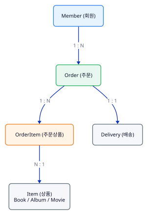
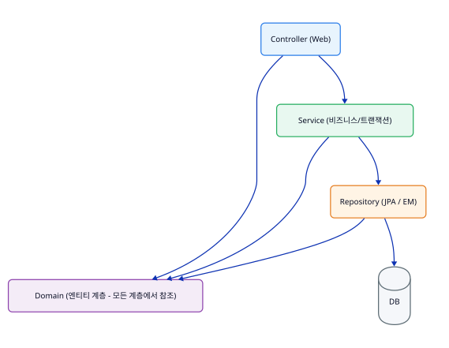

# 실전! 스프링 부트와 JPA 활용 (1편 & 2편)

---

## Part 1. 웹 애플리케이션 개발 (활용 1편)

## 1. 프로젝트 환경설정

### 1.1 스프링 부트 3.0 이상 환경 주의사항
- **Java 17 이상** 필수 사용.
- Java EE → Jakarta EE 전환에 따라 패키지명이 `javax.*`에서 **`jakarta.*`** 로 변경됨 (`jakarta.persistence.Entity`, `jakarta.validation.Valid`, `jakarta.annotation.PostConstruct`).
- H2 데이터베이스는 **2.1.214 이상** 권장 (H2 1.4.198 이후부터 `MVCC` 옵션 제거됨).

### 1.2 JPA와 DB 설정 (`application.yml`)

```yaml
spring:
  datasource:
    url: jdbc:h2:tcp://localhost/~/jpashop
    username: sa
    password:
    driver-class-name: org.h2.Driver

  jpa:
    hibernate:
      ddl-auto: create # 실행 시점에 테이블 DROP 후 재생성 (개발 전용)
    properties:
      hibernate:
        # show_sql: true  # System.out 출력 (실무 사용 지양)
        format_sql: true

logging:
  level:
    org.hibernate.SQL: debug               # 로거를 통해 SQL 출력
    org.hibernate.orm.jdbc.bind: trace     # 스프링 부트 3.x / Hibernate 6 바인딩 파라미터 출력
```

> [!NOTE]
> **쿼리 파라미터 로그 라이브러리 (`p6spy`)**
> `com.github.gavlyukovskiy:p6spy-spring-boot-starter:1.9.0` (스프링 부트 3.0+)을 추가하면 바인딩된 파라미터가 포함된 완성형 SQL을 확인할 수 있다. 단, 시스템 자원을 소모하므로 운영 환경 적용 전 반드시 성능 테스트가 필요하다.

---

## 2. 도메인 분석 설계

### 2.1 도메인 모델과 연관관계



* **회원(`Member`) ↔ 주문(`Order`)**: 일대다 / 다대일 양방향 관계 (`Order.member`가 외래 키 `ORDERS.MEMBER_ID`를 관리하는 주인).
* **주문(`Order`) ↔ 주문상품(`OrderItem`)**: 일대다 / 다대일 양방향 관계 (`OrderItem.order`가 주인).
* **주문상품(`OrderItem`) ↔ 상품(`Item`)**: 다대일 단방향 관계 (`OrderItem.item`이 주인).
* **주문(`Order`) ↔ 배송(`Delivery`)**: 일대일 양방향 관계 (`Order.delivery`가 주인).
* **카테고리(`Category`) ↔ 상품(`Item`)**: 다대다 관계 (`@ManyToMany`는 중간 테이블에 컬럼 추가가 불가능하고 숨겨진 쿼리가 발생하므로 실무에서는 연결 엔티티를 만들어 1:N, N:1로 풀어서 사용한다).
* **주소(`Address`)**: `@Embeddable` 값 타입 (`Member`, `Delivery`에서 공통 사용).

> [!NOTE]
> 테이블명이 `ORDER`가 아니라 `ORDERS`인 이유는 SQL 예약어 `ORDER BY`와의 충돌을 피하기 위함이다.

### 2.2 엔티티 설계 시 핵심 주의점 4가지

1. **가급적 Setter를 닫아두기**
   - Setter가 열려 있으면 변경 지점이 너무 많아 유지보수가 어렵다. 변경이 필요한 경우 의도가 드러나는 **비즈니스 메서드**를 별도로 제공한다.
2. **모든 연관관계는 지연 로딩(`FetchType.LAZY`)으로 설정**
   - 즉시 로딩(`EAGER`)은 어떤 SQL이 실행될지 예측하기 어렵고, 특히 JPQL 실행 시 **N+1 문제**의 주원인이 된다.
   - `@ManyToOne`, `@OneToOne`은 기본값이 `EAGER`이므로 **반드시 `fetch = FetchType.LAZY`를 명시**해야 한다.
   - 연관 엔티티를 함께 조회해야 할 때는 **페치 조인(`join fetch`)** 또는 **엔티티 그래프**를 사용한다.
3. **컬렉션은 필드에서 바로 초기화**
   - `private List<Order> orders = new ArrayList<>();`
   - `null` 문제에서 안전하며, 하이버네이트가 엔티티를 영속화할 때 컬렉션을 감싸 내장 컬렉션(`PersistentBag`)으로 교체하는 메커니즘이 망가지지 않는다.
4. **테이블/컬럼명 네이밍 전략**
   - 스프링 부트 기본 물리 네이밍 전략(`CamelCaseToUnderscoresNamingStrategy` / `SpringPhysicalNamingStrategy`)은 카멜 케이스(`memberPoint`)를 스네이크 케이스(`member_point`) 소문자로 자동 변환한다.
5. **값 타입은 불변 객체로 설계**
   - `@Embeddable` 클래스는 `@Setter`를 제거하고 생성자로만 초기화한다. JPA 리플렉션을 위해 `protected` 기본 생성자를 둔다.

## 3. 애플리케이션 구현 및 도메인 개발

### 3.1 애플리케이션 계층형 아키텍처



* **Controller (`web`)**: 웹 요청 처리 및 폼/DTO 검증
* **Service (`service`)**: 비즈니스 로직 위임 및 트랜잭션 경계 관리 (`@Transactional(readOnly = true)` 기본 적용, 쓰기 메서드만 `@Transactional`)
* **Repository (`repository`)**: `EntityManager`를 직접 사용하여 JPA 영속성 관리
* **Domain (`domain`)**: 엔티티와 핵심 비즈니스 로직 보관 (모든 계층에서 참조)

### 3.2 도메인 모델 패턴과 핵심 비즈니스 로직

비즈니스 로직 대부분을 서비스 계층이 아닌 **엔티티 내부**에 응집시키고, 서비스 계층은 단순히 엔티티에 필요한 요청을 위임하는 구조를 **도메인 모델 패턴(Domain Model Pattern)**이라 한다.

```java
// Item 엔티티: 재고 증가/감소 비즈니스 로직
public void addStock(int quantity) {
    this.stockQuantity += quantity;
}

public void removeStock(int quantity) {
    int restStock = this.stockQuantity - quantity;
    if (restStock < 0) {
        throw new NotEnoughStockException("need more stock");
    }
    this.stockQuantity = restStock;
}
```

```java
// Order 엔티티: 생성 메서드 & 주문 취소 로직
public static Order createOrder(Member member, Delivery delivery, OrderItem... orderItems) {
    Order order = new Order();
    order.setMember(member);
    order.setDelivery(delivery);
    for (OrderItem orderItem : orderItems) {
        order.addOrderItem(orderItem);
    }
    order.setStatus(OrderStatus.ORDER);
    order.setOrderDate(LocalDateTime.now());
    return order;
}

public void cancel() {
    if (delivery.getStatus() == DeliveryStatus.COMP) {
        throw new IllegalStateException("이미 배송완료된 상품은 취소가 불가능합니다.");
    }
    this.setStatus(OrderStatus.CANCEL);
    for (OrderItem orderItem : orderItems) {
        orderItem.cancel(); // 각 주문상품의 재고 원복
    }
}
```

> [!TIP]
> **동시성 이슈 방지**
> `MemberService.validateDuplicateMember()`처럼 애플리케이션에서 중복 회원을 검증하더라도 멀티 쓰레드 환경에서는 동시에 통과할 수 있으므로, DB 테이블의 회원명 컬럼에 **유니크(UNIQUE) 제약 조건**을 함께 추가하는 것이 안전하다.

### 3.3 동적 쿼리의 한계 (JPQL 문자열 조합 vs JPA Criteria)

* **JPQL 문자열 조합**: `where`, `and`를 조건문으로 이어 붙이는 방식은 번거롭고 오타로 인한 버그가 발생하기 쉽다.
* **JPA Criteria**: JPA 표준 스펙이지만 코드가 너무 복잡하고 직관적이지 않아 유지보수가 어렵다.
* **실무 해결책**: **Querydsl**을 사용하여 컴파일 시점에 타입 체크가 가능한 자바 코드로 동적 쿼리를 작성한다.
